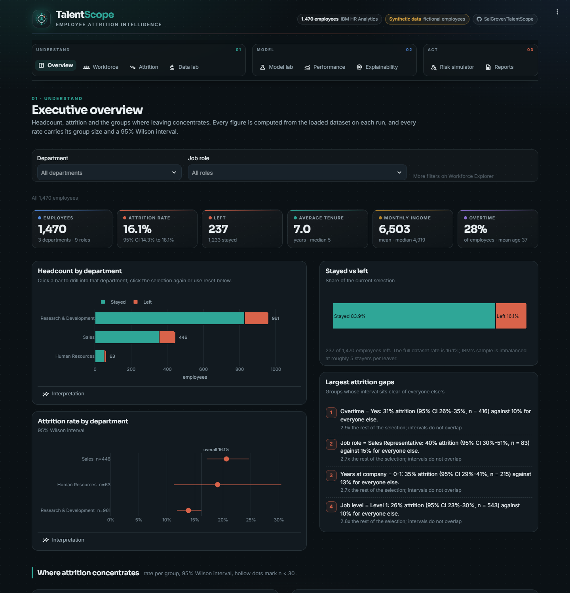
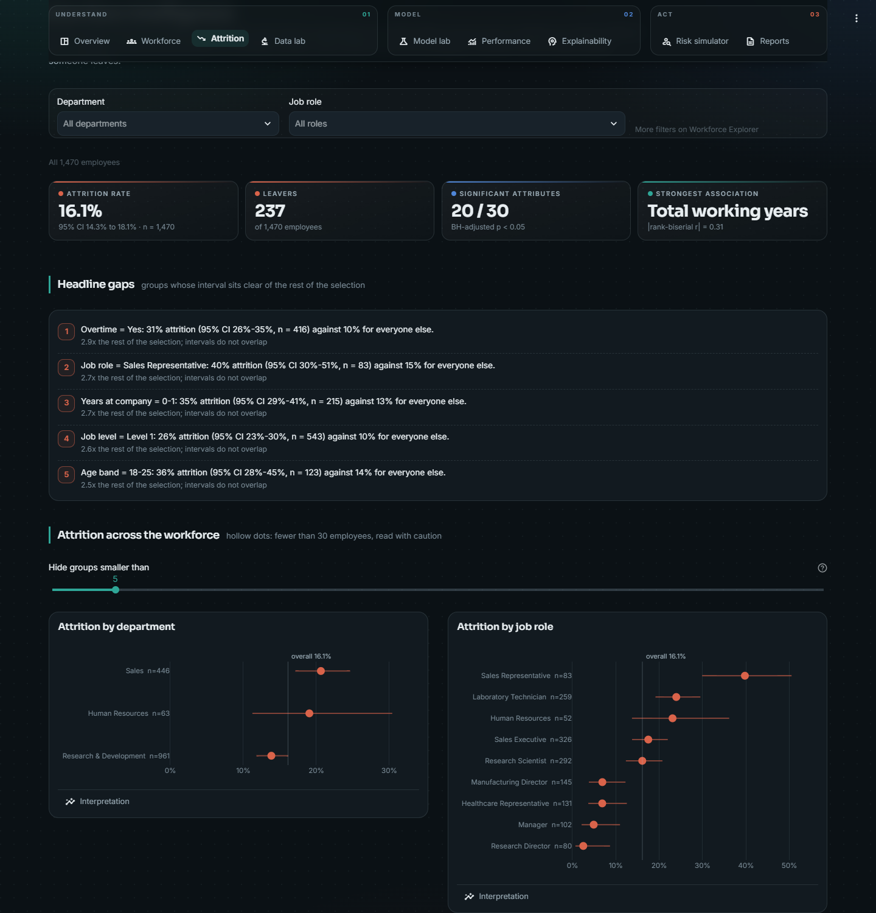
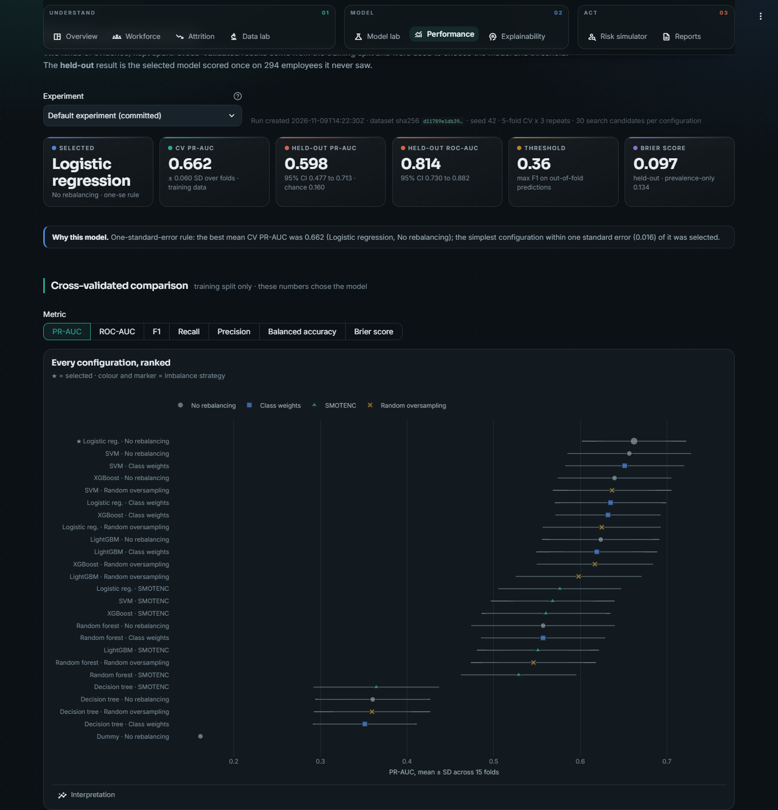
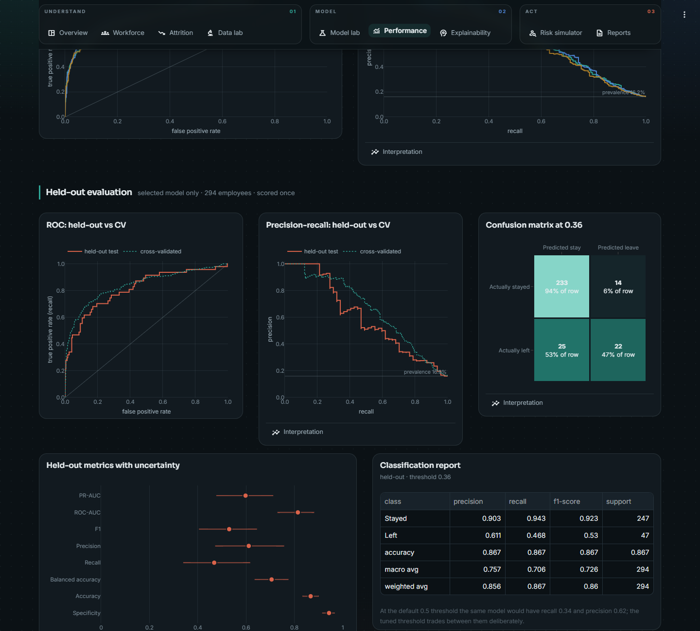
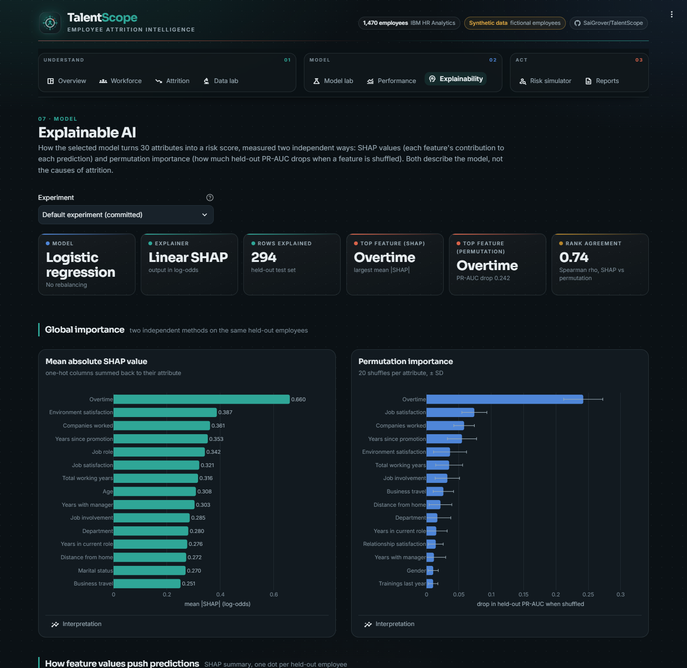
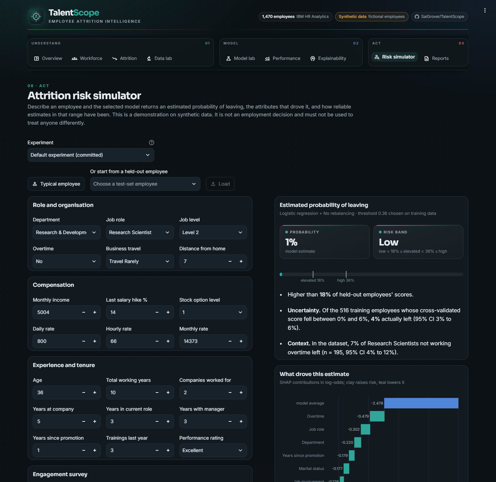
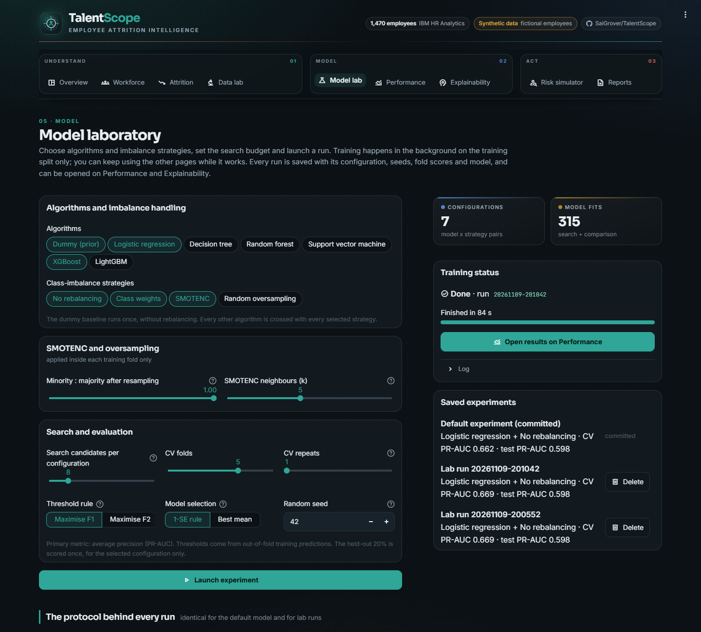

# TalentScope

**Employee attrition intelligence and explainable AI, built on the IBM HR Analytics dataset.**

TalentScope is a Streamlit platform for analysing why employees leave and how well that can be predicted. It covers
workforce analytics, interval-backed attrition analysis, data validation, a leakage-safe machine learning laboratory
with SMOTENC and class-weighting experiments, held-out evaluation with confidence intervals, SHAP explanations, a risk
simulator and downloadable reports. Eight executed notebooks document the same workflow and import the same Python
package as the app.

> **Synthetic data.** The IBM HR Analytics Employee Attrition & Performance dataset is fictional. It was created by IBM
> data scientists and does not describe real people. Nothing in this project should inform decisions about real
> employees.



---

## Contents

1. [Problem statement](#problem-statement)
2. [Dataset](#dataset)
3. [What the platform does](#what-the-platform-does)
4. [Architecture](#architecture)
5. [Machine learning workflow](#machine-learning-workflow)
6. [Results](#results)
7. [Explainability](#explainability)
8. [Reproducibility](#reproducibility)
9. [Running locally](#running-locally)
10. [Deploying to Streamlit Community Cloud](#deploying-to-streamlit-community-cloud)
11. [Testing](#testing)
12. [Responsible AI and limitations](#responsible-ai-and-limitations)
13. [How this differs from the original TalentScope](#how-this-differs-from-the-original-talentscope)

---

## Problem statement

Roughly one employee in six leaves in the IBM sample. HR teams want to know two things:

* **Where does attrition concentrate, and how confident can we be?** Descriptive analytics with honest denominators and
  intervals.
* **Can attrition be anticipated from HR records, and which attributes drive the estimate?** A validated, explainable
  classifier.

The second question is an imbalanced binary classification problem (237 leavers, 1,233 stayers). That makes the
evaluation protocol as important as the model.

## Dataset

| | |
|---|---|
| Name | IBM HR Analytics Employee Attrition & Performance |
| Source | [Kaggle: pavansubhasht/ibm-hr-analytics-attrition-dataset](https://www.kaggle.com/datasets/pavansubhasht/ibm-hr-analytics-attrition-dataset) |
| File used | `data/raw/ibm_hr_employee_attrition.csv`, the same file as published in IBM's public [employee-attrition-aif360](https://github.com/IBM/employee-attrition-aif360) repository (no Kaggle credentials needed) |
| Version pin | SHA-256 `d11789e1db393cd1d985ca41a0e73a1d405543fb2c0d540a3b4f7d723bca92f7` |
| Size | 1,470 rows × 35 columns |
| Target | `Attrition` (Yes / No): 237 left (16.1%), 1,233 stayed |
| Licence | fictional data by IBM; redistributed under the Kaggle dataset's Open Database License |

**Validation** (`talentscope.data.validate_dataset`, shown live on the *Data lab* page):

* **Structure:** shape, schema and types match the data dictionary.
* **Missing values:** none.
* **Duplicates:** none, including when the identifier is ignored.
* **Value checks:** every category is documented, every numeric value is in range, and the tenure constraints are
  consistent.
* **Leakage screen:** no single feature exceeds a univariate ROC-AUC of 0.68.

**Dropped before modelling:** `EmployeeNumber` (an identifier) and `EmployeeCount`, `Over18` and `StandardHours`
(constants). The other **30 attributes** are used: 14 numeric, 9 ordinal and 7 nominal.

**Limitations of the data.**

* **Small sample.** There are 237 leavers in total, and only about 47 in a 20% test set.
* **Correlated features.** Job level, income, age and tenure are strongly correlated; for example, monthly income and
  job level correlate at r = 0.95.
* **Little-used attribute.** `PerformanceRating` takes only two values.
* **Synthetic origin.** The data is synthetic, so patterns may not exist in any real organisation.

## What the platform does

`streamlit run app.py` opens a nine-page app. A navigation rail groups the pages into three phases.

| Phase | Page | What it offers |
|---|---|---|
| Understand | **Overview** | KPI tiles, headcount by department with click-to-drill-down, attrition by department, role, overtime and age with Wilson intervals, auto-generated "largest gap" findings, and a model snapshot read from artefacts |
| | **Workforce** | Organisation, demographics, pay and level, career and engagement views, plus a searchable and downloadable employee table; filters on department, role, gender, overtime and age persist across pages |
| | **Attrition** | Rates across ten dimensions (department, role, overtime, age, income, tenure, job satisfaction, work-life balance, travel, promotion), a two-attribute heatmap, chi-square and Mann-Whitney tests with Benjamini-Hochberg correction, and leaver-versus-stayer comparisons |
| | **Data lab** | Validation report, leakage screen, schema explorer, raw preview, univariate and bivariate explorers, Spearman and Cramér's V matrices, IQR outliers and target / missing-value views |
| Model | **Model lab** | Choose algorithms, imbalance strategies, SMOTENC ratio and *k*, search budget, CV folds and repeats, threshold rule, selection rule and seed. Runs train in a separate process, so the rest of the app stays responsive, and are saved with full metadata |
| | **Performance** | Every configuration ranked with fold SD, a strategy × algorithm heatmap, a "did rebalancing help?" table, fold variability, out-of-fold ROC and PR curves, then the held-out ROC, PR, confusion matrix, bootstrap intervals, classification report, calibration, threshold explorer, resampling evidence and group error rates |
| | **Explainability** | SHAP versus permutation importance, a SHAP summary (beeswarm), learned directions, dependence plots and per-employee waterfall explanations |
| Act | **Risk simulator** | A validated form for one employee, with probability, documented risk band, calibration-based uncertainty, a group base rate and a local SHAP waterfall |
| | **Reports** | Workforce and attrition reports (Markdown or self-contained HTML), model evaluation summary, model card, experiment comparison CSV and test-set predictions |

### Screenshots

| | |
|---|---|
|  |  |
| **Attrition:** rates with Wilson intervals and group sizes | **Performance:** every configuration ranked by CV PR-AUC ± SD |
|  |  |
| **Held-out evaluation:** test versus CV curves and confusion matrix | **Explainability:** SHAP versus permutation importance |
|  |  |
| **Risk simulator:** validated inputs, risk band and uncertainty | **Model lab:** configure and launch reproducible experiments |

### Design

The interface adapts the Data Vortex Round 4 dashboard's design language to HR analytics:

* **Navigation:** a pipeline rail serves as the navigation, grouped into Understand, Model and Act.
* **Page structure:** every page opens with a tile strip with accent rules, then a grid of identical opaque cards.
* **Interpretation:** each chart has an *Interpretation* expander that says what the chart shows and why it matters.
* **Method flow:** the Model lab shows the protocol as a vertical method flow.
* **Visual identity:**
  * **Canvas:** a cooler ink canvas with radial glows and a dot grid instead of photographic artwork.
  * **Fonts:** Sora for display text and Inter for body text.
  * **Colour meaning:** teal always means *stayed* and clay always means *left*.
* **Validated colours:** every categorical palette passed a colour-vision-deficiency, contrast and lightness validator
  against the actual card surface. Where hue alone fell short for scatter charts, strategy markers use distinct shapes
  as well as colours.

## Architecture

```text
TalentScope/
├── app.py                       entry point: page config, design layer, navigation rail, st.navigation
├── app_pages/                   one script per page (1_executive_overview.py … 9_reports.py)
├── src/talentscope/
│   ├── config.py                paths, seeds, protocol constants
│   ├── data/                    loader, schema knowledge, validation report
│   ├── preprocessing/           stratified split, imputer / encoder builders
│   ├── modeling/                model registry, experiment runner, artefacts, inference, run_job (subprocess)
│   ├── evaluation/              metrics, bootstrap CIs, Wilson intervals, thresholds, calibration, group metrics
│   ├── explainability/          SHAP (tree / linear / kernel), permutation importance, persistence
│   ├── analytics/               workforce KPIs, group rates, association tests, correlations, outliers
│   ├── reporting/               Markdown / HTML reports, model card, notebook figure style
│   └── ui/                      design tokens, Plotly builders, components and CSS, cached state, background jobs
├── data/raw/                    the IBM CSV (+ data/README.md)
├── experiments/default/         committed evidence for the default model (see Reproducibility)
├── models/default/              model.joblib + model_metadata.json
├── notebooks/                   eight executed notebooks + README
├── scripts/                     train_default.py, build_notebooks.py, update_readme_results.py, smoke_pages.py
├── tests/                       pytest suite (data, preprocessing, leakage, modelling, metrics, SHAP, reports, app)
├── assets/screenshots/
├── .streamlit/config.toml       locked dark theme, fonts, chart palette
├── requirements.txt             pinned runtime dependencies
└── requirements-dev.txt         + pytest and notebook tooling
```

The UI never computes a model metric itself. Pages call `talentscope.*` functions or read saved artefacts. Expensive
objects are cached with `st.cache_data` and `st.cache_resource`; filters run outside the cache on every rerun.

## Machine learning workflow

```text
1,470 employees ──stratified 80/20 split (seed 42)──► 1,176 train │ 294 test (untouched)
                                                       │
   for each algorithm × imbalance strategy:            │
     RandomizedSearchCV (30 candidates, 5-fold stratified CV, PR-AUC)
     repeated stratified CV 3×5 (different seed) → fold scores + out-of-fold probabilities
                                                       │
   select model: one-standard-error rule on mean CV PR-AUC
   select threshold: max F1 on out-of-fold probabilities
                                                       │
   refit selected pipeline on all 1,176 ──────────────► score the 294 test employees once
                                                        + stratified bootstrap (1,000) for 95% CIs
```

**Pipeline per fold** (`imblearn.pipeline.Pipeline`): impute (median / most frequent) → *optional resample* → round
integer codes → standardise (logistic regression and SVM only) → one-hot encode (unknown categories ignored) → model.
Because the whole chain is one estimator, cross-validation refits every learned step on each training fold.

**Models.** Dummy (prior), logistic regression, decision tree, random forest, SVM (RBF), XGBoost and LightGBM, each
with a small, meaningful search space.

**Class imbalance.** Four strategies are compared under identical folds and budgets:

* **No rebalancing:** the baseline.
* **Inverse-frequency class weights:** for XGBoost, `scale_pos_weight`.
* **SMOTENC:** chosen because the data mixes numeric and nominal features. Nominal values are never interpolated, and
  integer codes are rounded back to valid values.
* **Random oversampling.**

Sampling ratio and *k* are configurable in the Model lab. Samplers live inside the pipeline, so they only ever see
training folds. The tests verify this by recording every call SMOTENC receives during cross-validation.

**Metrics.**

* **Primary:** PR-AUC (average precision).
* **Also reported:** ROC-AUC, F1, precision, recall, balanced accuracy, accuracy and specificity.
* **Probability quality:** Brier score and calibration curves.
* **Supporting detail:** confusion matrices, classification reports, CV mean ± SD and held-out 95% bootstrap intervals.

## Results

<!-- RESULTS:START -->

_Generated from `experiments/default` (run 2026-11-09T14:22:30Z, dataset sha256 `d11789e1db39…`, seed 42). Regenerate with `python scripts/train_default.py` then `python scripts/update_readme_results.py`._

**Selected:** Logistic regression with no rebalancing, C = 0.254, decision threshold 0.36 (max F1 on out-of-fold training predictions).

**Held-out test set** (294 employees, 47 leavers, scored once; 95% stratified bootstrap intervals):

| Metric | Estimate | 95% CI |
|---|---|---|
| PR-AUC | 0.598 | 0.477 to 0.713 |
| ROC-AUC | 0.814 | 0.730 to 0.882 |
| F1 | 0.530 | 0.405 to 0.645 |
| Precision | 0.611 | 0.472 to 0.758 |
| Recall | 0.468 | 0.340 to 0.617 |
| Balanced accuracy | 0.706 | 0.635 to 0.776 |
| Accuracy | 0.867 | 0.833 to 0.901 |
| Brier score | 0.097 | 0.082 to 0.114 |

Chance-level PR-AUC (the attrition rate) is 0.160. Always predicting the base rate gives a Brier score of 0.134.

**Cross-validated comparison** on the training split (3 × 5-fold repeated stratified CV, mean ± SD of PR-AUC):

| Algorithm | No rebalancing | Class weights | SMOTENC | Random oversampling |
|---|---|---|---|---|
| Logistic regression | **0.662 ± 0.060** | 0.635 ± 0.064 | 0.576 ± 0.071 | 0.625 ± 0.068 |
| Support vector machine | 0.657 ± 0.071 | 0.651 ± 0.069 | 0.568 ± 0.071 | 0.637 ± 0.069 |
| XGBoost | 0.640 ± 0.066 | 0.632 ± 0.061 | 0.560 ± 0.074 | 0.617 ± 0.067 |
| LightGBM | 0.624 ± 0.068 | 0.619 ± 0.070 | 0.551 ± 0.070 | 0.598 ± 0.073 |
| Random forest | 0.557 ± 0.083 | 0.557 ± 0.072 | 0.529 ± 0.067 | 0.546 ± 0.072 |
| Decision tree | 0.360 ± 0.066 | 0.351 ± 0.060 | 0.365 ± 0.072 | 0.360 ± 0.067 |
| Dummy (prior) | 0.162 ± 0.000 | n/a | n/a | n/a |

SMOTENC changed mean CV PR-AUC by -0.089 to +0.004 across 6 algorithms (lower for 5). It raised recall at a 0.5 threshold, but at the cost of calibration, and did not improve ranking quality. The experiment is reported as run; SMOTENC remains available in the Model laboratory.

**Most influential attributes** (held-out set). By mean |SHAP|: Overtime, Environment satisfaction, Companies worked, Years since promotion, Job role, Job satisfaction. By permutation importance: Overtime, Job satisfaction, Companies worked, Years since promotion, Environment satisfaction, Total working years.

<!-- RESULTS:END -->

**Interpretation.** Every model beats the dummy baseline, but the top configurations are separated by less than the
fold-to-fold standard deviation. The one-standard-error rule picks the simplest of them, which is also the best by
mean. Rebalancing, including SMOTENC, mainly shifts predicted probabilities upward, much like lowering the threshold.
It raises recall at 0.5 and worsens calibration without improving ranking, so the selected model uses no rebalancing
and an explicitly tuned threshold instead. The held-out estimate is consistent with cross-validation, and its intervals
are wide because the test set holds about 47 leavers.

## Explainability

* **Global:** mean |SHAP| aggregated from one-hot columns back to the 30 attributes, compared with permutation
  importance (drop in held-out PR-AUC, 20 shuffles), plus their rank correlation.
* **Summary and dependence:** beeswarm and dependence plots for any input.
* **Local:** waterfall explanations for any test employee, and live in the risk simulator.
* **Explainer per model family:**
  * **Linear SHAP:** logistic regression.
  * **Tree SHAP:** decision tree, random forest, XGBoost and LightGBM.
  * **Kernel SHAP:** the SVM.
* **Verified additivity:** tests check that base value plus SHAP contributions reconstruct each model's predictions.

SHAP values explain the model's use of an input in this synthetic sample. They are not causal effects. Correlated
career attributes (age, experience, tenure, level, income) share credit in ways that depend on the model, which is why
SHAP and permutation rankings differ for them.

## Reproducibility

Each run directory (`experiments/default`, or `experiments/runs/<id>` for lab runs) contains:

| File | Contents |
|---|---|
| `config.json` | the exact `ExperimentConfig` (models, strategies, budget, folds, seed, SMOTENC settings) |
| `metadata.json` | dataset hash, split sizes, protocol, library versions, runtime |
| `selection.json` | selected model, parameters, threshold and the reason it was chosen |
| `cv_summary.csv`, `cv_folds.csv`, `search_trials.csv` | every configuration, every fold, every search candidate |
| `oof_predictions.csv`, `test_predictions.csv` | out-of-fold training probabilities; held-out probabilities |
| `test_metrics.json`, `test_bootstrap.csv`, `test_curves.json`, `calibration_*.csv`, `classification_report.csv` | held-out evaluation |
| `resampling.json` | class counts before and after resampling inside a training fold |
| `explain/` | SHAP values, permutation importance, group error rates |
| `model.joblib` | the fitted pipeline (the default model lives in `models/default/`) |

Regenerate everything:

```bash
python scripts/train_default.py
```

```bash
python scripts/update_readme_results.py
```

```bash
python scripts/build_notebooks.py
```

Notebook 05 re-runs the full experiment from scratch and asserts that its results match the committed artefacts.

## Running locally

Python 3.11 or newer is required (developed on 3.13).

```bash
git clone https://github.com/SaiGrover/TalentScope.git
```

```bash
cd TalentScope
```

```bash
pip install -r requirements.txt
```

```bash
streamlit run app.py
```

The default model and its evidence are committed, so the app works immediately with no training step, secrets or
external services.

## Deploying to Streamlit Community Cloud

1. Push the repository to GitHub.
2. In Streamlit Community Cloud, create an app from `SaiGrover/TalentScope`, branch `main`, main file `app.py`.
3. Under advanced settings, choose Python 3.12 or 3.13.

The app needs no secrets. Lab runs train in a single process, in a separate Python process from the web server, to
stay within Community Cloud's memory limit. Saved lab runs live on the container's disk and disappear when the app
restarts; the committed default run does not.

## Testing

```bash
pip install -r requirements-dev.txt
```

```bash
pytest
```

The suite contains 58 tests:

* **Data:** schema, target and validation, including checks that it catches injected errors and a planted label proxy.
* **Split and preprocessing:** split stratification and disjointness, scaler and imputer statistics coming from
  training rows only, and handling of unknown categories.
* **SMOTENC isolation:** SMOTENC output validity, and SMOTENC receiving only training-fold rows during
  cross-validation, never at prediction time.
* **Models:** every model fits and predicts, the experiment structure is correct, and the threshold provably comes
  from out-of-fold training predictions.
* **Artefacts:** serialisation round trip, and the committed model reproducing its saved test predictions.
* **Metrics and explanations:** metric correctness, bootstrap intervals and SHAP additivity for linear and tree models.
* **Reports:** report generation from artefacts.
* **App:** every page renders headlessly via `AppTest`, filters change results, the simulator rejects inconsistent
  input, and downloads are offered.
* **Clean-up guarantees:** no Flask or job-change code remains, and no hard-coded metric values appear in the pages.

## Responsible AI and limitations

* **Not a decision tool.** Scores are estimates from a model trained on fictional data. They must not be used for
  hiring, promotion, pay, performance management or dismissal decisions, and the simulator says so.
* **Sensitive attributes.** The dataset includes gender, age and marital status, and the model uses them. The
  Performance page reports recall and false-positive rates by group. In the default model, employees aged 18 to 25 are
  flagged far more often, with a higher false-positive rate. Removing protected attributes would not by itself fix
  this, because tenure, level and income carry similar information.
* **Small sample.** Held-out metrics rest on about 47 leavers and are always shown with intervals. Model comparisons use
  cross-validation, and differences smaller than the fold SD are treated as noise.
* **Associations, not causes.** Attrition analytics and SHAP describe patterns in the sample. They cannot say what
  would happen if an attribute changed.
* **Multiple comparisons.** Association tests are Benjamini-Hochberg adjusted. Group charts mark small groups and allow
  a minimum group size.

## How this differs from the original TalentScope

| | Original (v1) | This rebuild (v2) |
|---|---|---|
| Problem | job-change prediction for a Kaggle competition (`aug_train.csv`, 19,158 rows) | employee attrition, IBM HR Analytics (1,470 rows) |
| Stack | Flask API + single HTML template | Streamlit multipage app + a tested `talentscope` package |
| Training data | every model fitted on a 1,200-row random sample of ~15,000 training rows | full training split; no caps |
| Leakage control | encoders and scaler fitted before the validation split | imputer, sampler, scaler and encoder refitted inside every CV fold |
| Validation | 2-fold CV; thresholds tuned on the validation set that was also reported | 5-fold search CV, 3×5 repeated CV for comparison, thresholds from out-of-fold predictions, test set scored once |
| Imbalance | `class_weight="balanced"` only | none / class weights / SMOTENC / random oversampling, compared head to head |
| Explainability | coefficient and impurity charts (a "SHAP" placeholder that returned nothing) | real SHAP (linear / tree / kernel) + permutation importance |
| Uncertainty | none | bootstrap intervals, Wilson intervals, CV SD, calibration |
| Reproducibility | in-memory state only | saved configs, seeds, data hash, fold scores, predictions, models; a notebook that re-runs and compares |
| Tests / notebooks | none | 58 pytest tests; eight executed notebooks |

The Flask routes, HTML template, job-change datasets and the `pipeline/` package were removed. The original's idea of
a step-by-step pipeline survives as the Understand → Model → Act navigation and the method flow in the Model lab.

---

Licensed under the repository's [LICENSE](LICENSE).
